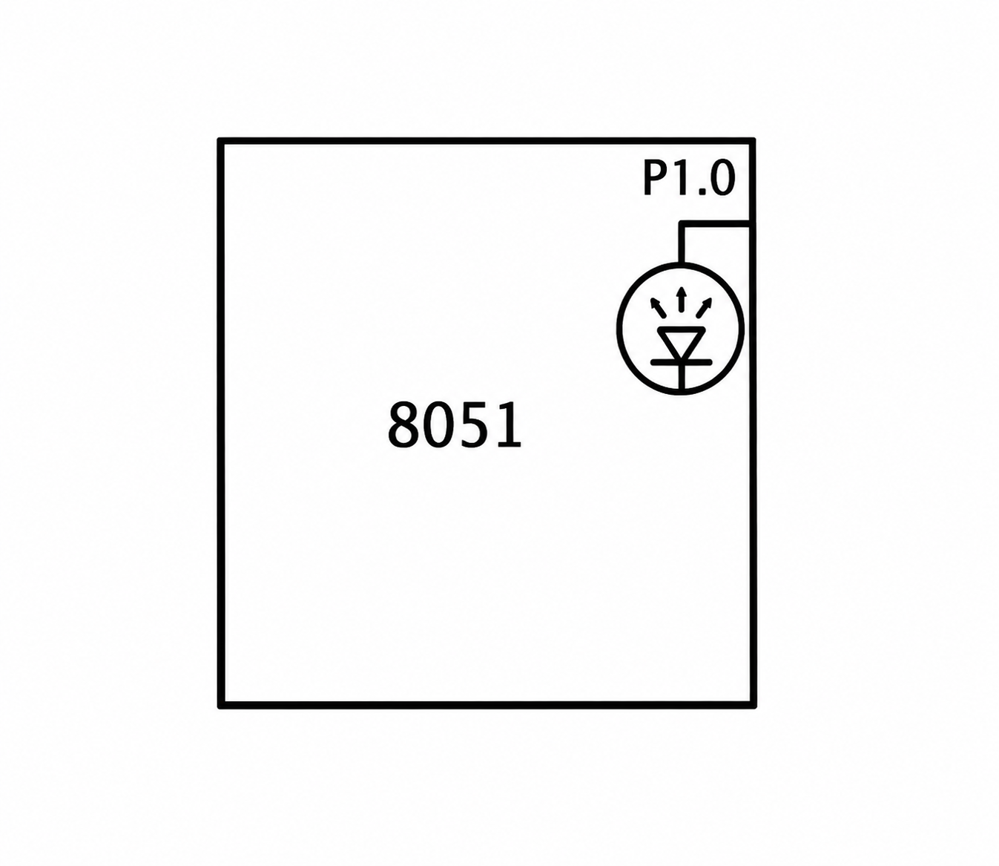

# CAT2 - Experiment Overview

GPIO output and LED control with the AT89S52.

## Tasks

- [TASK2B](TASK2B/README.md) - Use an AT89S52 digital output to switch an LED on and off with a software delay.

## Circuit Overview

