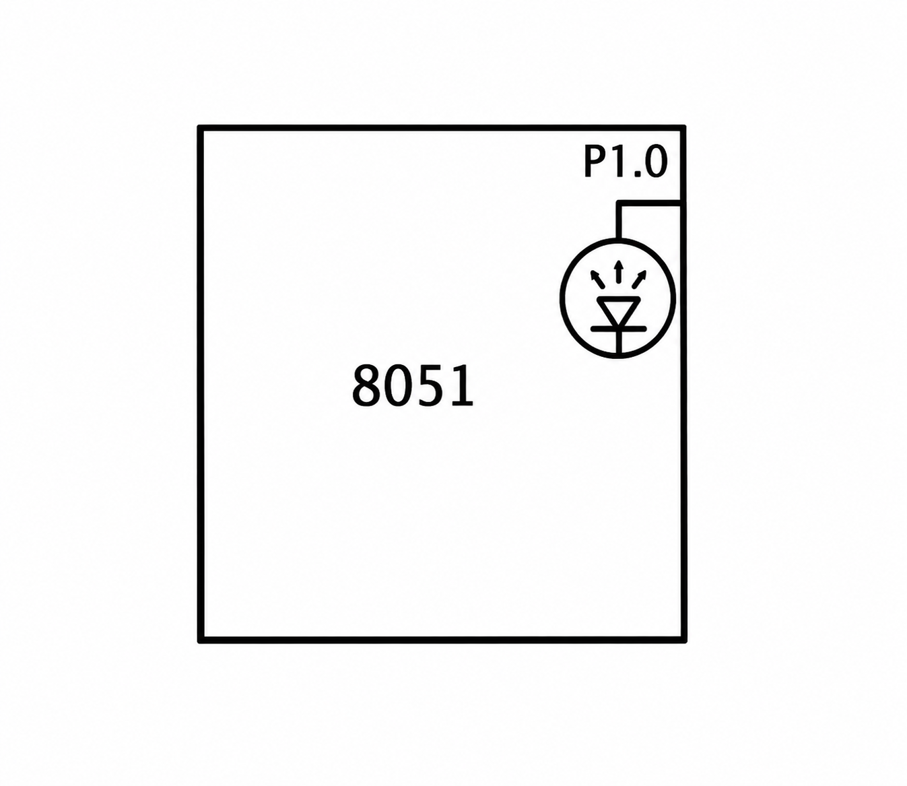

# 8051 LED Blink with GPIO

## Circuit / System Diagram

## Aim
Use an AT89S52 digital output to switch an LED on and off with a software delay.

## Hardware and Components
- AT89S52 microcontroller board
- LED with a current-limiting resistor

## Concepts Used
- GPIO output control
- Software delay loops

## Pin Connections / Wiring
| Component | Microcontroller pin | Purpose |
|---|---|---|
| LED | P1.0 | Alternating digital output |

## Working / Implementation
The program configures the LED output through the 8051 port bit. It drives the pin high, waits in a nested delay loop, drives it low, and repeats.

## Expected Output
The LED connected to P1.0 repeatedly turns on and off.
