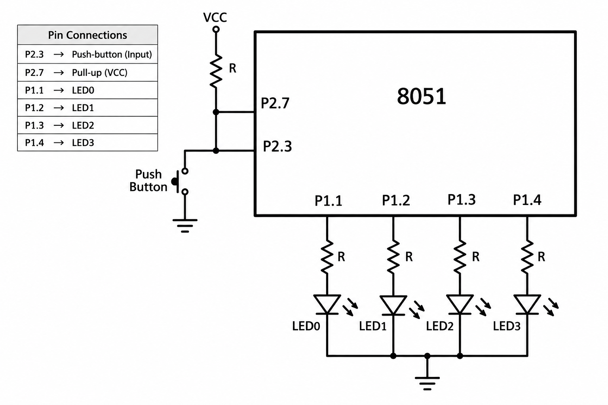

# CAT3 - Experiment Overview

Digital input polling and LED response on the AT89S52.

## Tasks

- [TASK3A](TASK3A/README.md) - Use a push-button input to select and observe four LED patterns on an AT89S52.

## Circuit Overview

