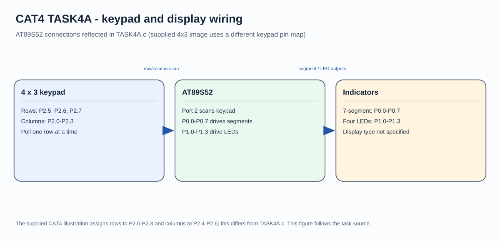

# CAT4 - Experiment Overview

Matrix keypad scanning, seven-segment output, and LED patterns.

## Tasks

- [TASK4A](TASK4A/README.md) - Read a numeric key from a matrix keypad, display the selected digit, and demonstrate LED patterns on the AT89S52.

## Circuit Overview

