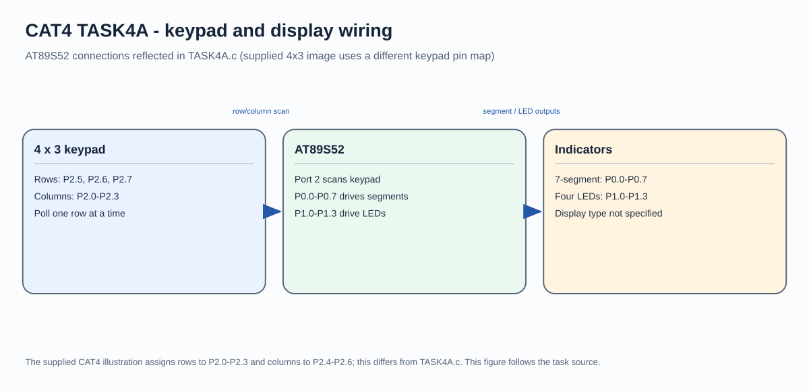

# 8051 Keypad and Seven-Segment Display

## Circuit / System Diagram

## Aim
Read a numeric key from a matrix keypad, display the selected digit, and demonstrate LED patterns on the AT89S52.

## Hardware and Components
- AT89S52 microcontroller board
- Numeric matrix keypad
- Seven-segment display and suitable current-limiting/interface circuitry
- Four LEDs with current-limiting resistors

## Concepts Used
- Matrix keypad scanning and polling
- Seven-segment digit encoding
- GPIO control
- LED patterns

## Pin Connections / Wiring
| Component | Microcontroller pin | Purpose |
|---|---|---|
| Seven-segment signals | P0.0–P0.7 | Segment pattern output |
| Four LEDs | P1.0–P1.3 | Running, binary, alternating, and blink patterns |
| Keypad row signals | P2.5–P2.7 | Three scanned rows |
| Keypad column signals | P2.0–P2.3 | Four sensed columns; P2.4 is unused by the scan |

The source scans a three-row by four-column matrix on Port 2; the supplied task materials do not establish a separate connector pinout. Port 0 requires the display interface appropriate to the board.

## Working / Implementation
The firmware scans keypad lines and stores the detected numeric key. It sends the matching segment pattern to Port 0 and uses the key value to select one of the four LED behaviors. The source includes codes for digits 0–9.

## Expected Output
A detected numeric key is represented on the seven-segment display while the four LEDs show the associated pattern behavior.
