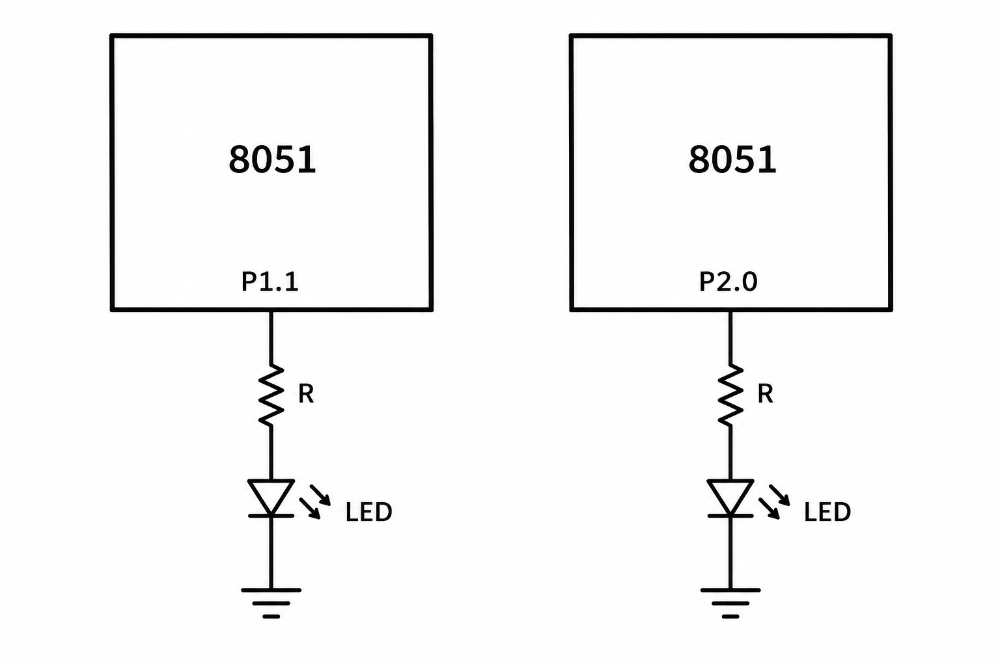

# CAT 5 – Hardware Timer and Interrupt-Based Timing for LED Fading and Pulse Generation

## EXP
CAT 5

## DATE
10/08/2026 (Week 4)

## NAME OF EXP
Hardware Timer and Interrupt-Based Timing for LED Fading and Pulse Generation

## HARDWARE SETUP / PLATFORM
- AT89S52 Development Board
- LEDs
- Resistors
- Keil µVision
- Embedded C

## TASK NO

### Task 1 – LED Blinking Using Timer 0

Configure Timer 0 to generate periodic timing events. Use the timer to toggle an LED at regular intervals.

### Task 2 – LED Fading Using Software PWM

Generate a software PWM signal using Timer 0 and gradually vary the duty cycle from 0% to 100% and back to 0%, producing a visible LED fading effect.

## CIRCUIT DIAGRAM

## CORE LOGIC / PSEUDOCODE / CODE BASE

### Pin Configuration

| Component | 8051 Pin |
|---|---|
| LED (Task 1) | P1.1 |
| PWM LED (Task 2) | P2.0 |

### Source Code 1 – cat50.c

- Configure Timer 0 in Mode 1.
- Load the timer registers TH0 and TL0.
- Enable Timer 0 and start the timer.
- Monitor the timer overflow flag.
- Increment the millisecond counter.
- Toggle the LED when the counter reaches 200.

### Source Code 2 – cat51.c

- Configure Timer 0 in Mode 2.
- Initialize the timer interrupt.
- Increment the PWM counter inside the Timer 0 interrupt service routine.
- Compare the PWM counter with the duty cycle.
- Set or clear the PWM output accordingly.
- Gradually increase the duty cycle from 0 to 100 and decrease it back to 0.

## INFERENCE

The experiment demonstrates timer-based LED control and software PWM generation using the AT89S52. The PWM duty cycle variation produces changes in LED brightness, illustrating timer-controlled output generation.
