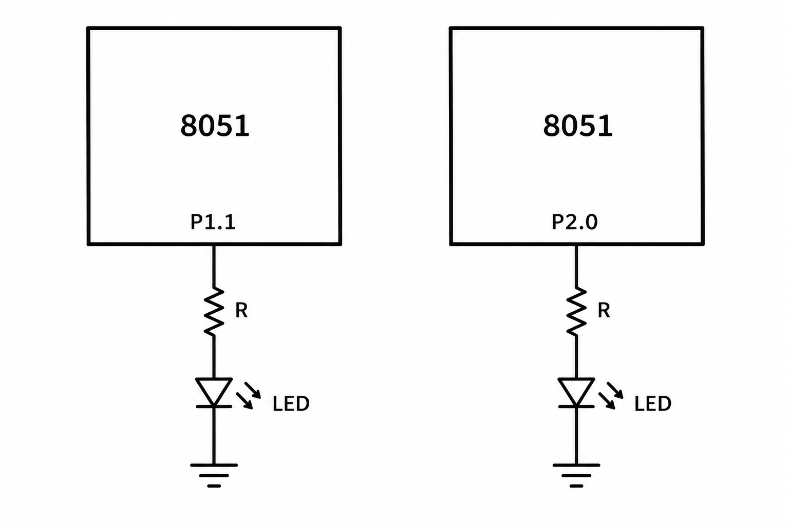

# 8051 Timer-Driven LED Blink

## Circuit / System Diagram

## Aim
Use the AT89S52 Timer 0 interrupt to create a regular timebase and blink an LED at approximately one-second intervals.

## Hardware and Components
- AT89S52 microcontroller board with 11.0592 MHz clock
- LED with a current-limiting resistor

## Concepts Used
- Timer 0, 16-bit mode
- Timer overflow interrupt
- Millisecond tick counting
- GPIO output control

## Pin Connections / Wiring
| Component | Microcontroller pin | Purpose |
|---|---|---|
| LED | P1.1 | Output toggled by elapsed-time logic |

## Working / Implementation
Timer 0 is configured for a roughly 1 ms interrupt tick using the 11.0592 MHz clock. The interrupt reloads the timer and increments a millisecond counter; the main loop toggles the LED after about 1,000 ticks.

## Expected Output
The LED on P1.1 changes state at about one-second intervals.
