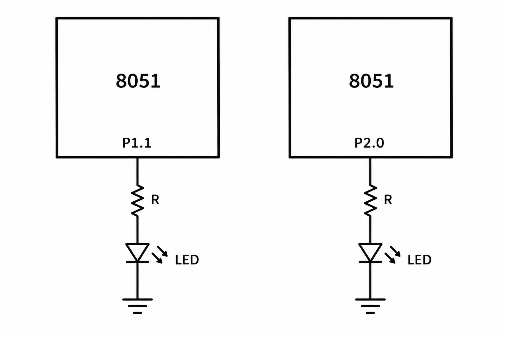

# 8051 Timer-Generated Frequency Steps

## Circuit / System Diagram

## Aim
Generate a square wave on an AT89S52 output and cycle through several nominal frequencies.

## Hardware and Components
- AT89S52 microcontroller board with 11.0592 MHz clock
- Oscilloscope, frequency counter, or other suitable signal observation input

## Concepts Used
- Timer 0 interrupt timing
- Digital waveform generation
- Frequency and half-period selection

## Pin Connections / Wiring
| Component | Microcontroller pin | Purpose |
|---|---|---|
| Signal observation point | P1.1 | Square-wave output |

## Working / Implementation
Timer 0 interrupts at approximately 50 μs intervals. A tick counter toggles P1.1 after a mode-dependent number of ticks. The firmware cycles through nominal settings of 100, 500, 1,000, 2,000, and 5,000 Hz.

## Expected Output
P1.1 produces a square wave whose nominal frequency changes through the five programmed settings.
