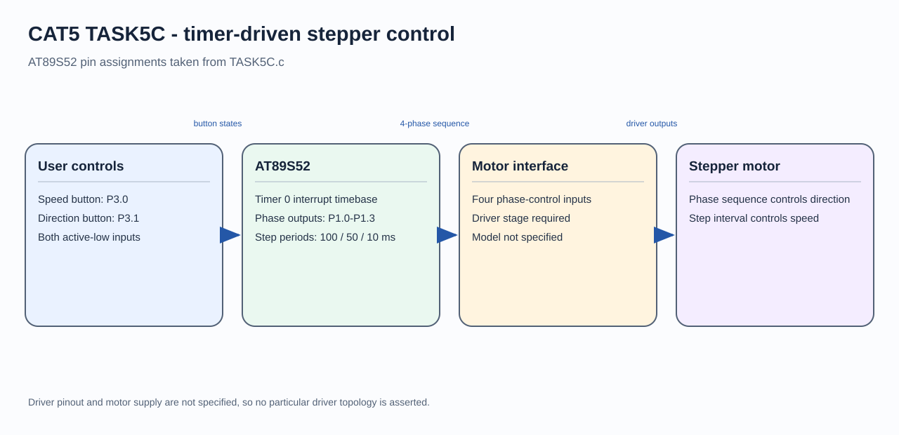

# 8051 Stepper Motor Speed and Direction

## Circuit / System Diagram

## Aim
Control a four-phase stepper motor from an AT89S52, with selectable step interval and rotation direction.

## Hardware and Components
- AT89S52 microcontroller board with 11.0592 MHz clock
- Four-phase stepper motor
- ULN2003 or suitable transistor driver and motor supply
- Two push-buttons

## Concepts Used
- Timer 0 interrupt timebase
- Four-phase stepping sequence
- Button polling and debounce
- Speed and direction control

## Pin Connections / Wiring
| Component | Microcontroller pin | Purpose |
|---|---|---|
| Driver phase inputs | P1.3–P1.0 | Sequence `1000, 0100, 0010, 0001` |
| Speed button | P3.0 | Active-low speed selection |
| Direction button | P3.1 | Active-low direction toggle |

Connect motor coils through the driver, use a suitable motor supply, and share ground with the controller. Do not connect motor coils directly to MCU pins.

## Working / Implementation
Timer 0 produces approximately 1 ms ticks. The foreground code schedules the next phase according to the selected 100, 50, or 10 ms step period. A debounced press on P3.0 advances the speed setting; a press on P3.1 reverses the phase order.

## Expected Output
The motor advances through the four-phase sequence. Button presses change its step rate or reverse its direction.
