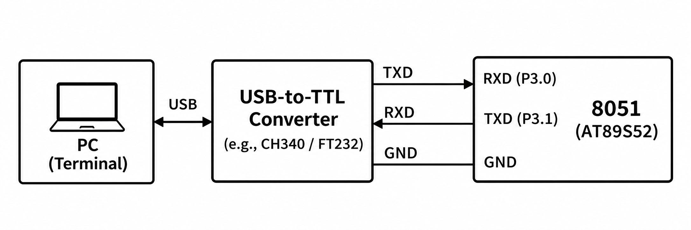

# CAT6 - Experiment Overview

8051 UART transmit, receive, and terminal echo.

## Tasks

- [TASK6A](TASK6A/README.md) - Initialize the AT89S52 UART and repeatedly transmit a greeting to a serial terminal.
- [TASK6B](TASK6B/README.md) - Receive serial characters on the AT89S52 and return each character to the sender.

## Circuit Overview

