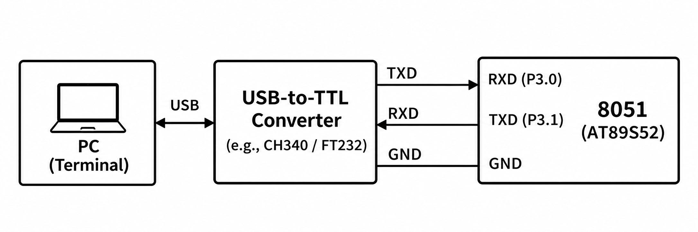

# 8051 UART Transmit and Serial Debugging

## Circuit / System Diagram

## Aim
Initialize the AT89S52 UART and repeatedly transmit a greeting to a serial terminal.

## Hardware and Components
- AT89S52 microcontroller board with 11.0592 MHz clock
- USB-to-TTL serial interface or compatible serial terminal

## Concepts Used
- UART serial transmission
- Timer 1 mode 2 baud generation
- UART transmit interrupt

## Pin Connections / Wiring
| Component | Microcontroller pin | Purpose |
|---|---|---|
| Serial adapter RX | P3.1 / TXD | Receives MCU text |
| Serial adapter TX | P3.0 / RXD | UART receive pin; unused by this transmit task |
| Ground | GND | Shared signal reference |

Configure the serial link for 9600 baud, 8 data bits, no parity, and one stop bit.

## Working / Implementation
The UART uses 8-bit serial mode with reception enabled, while Timer 1 mode 2 and reload `0xFD` establish the baud rate. The transmit interrupt releases each character transfer; the main loop sends `Hello from 8051` followed by a line break and delay.

## Expected Output
The terminal repeatedly displays `Hello from 8051` on separate lines.
