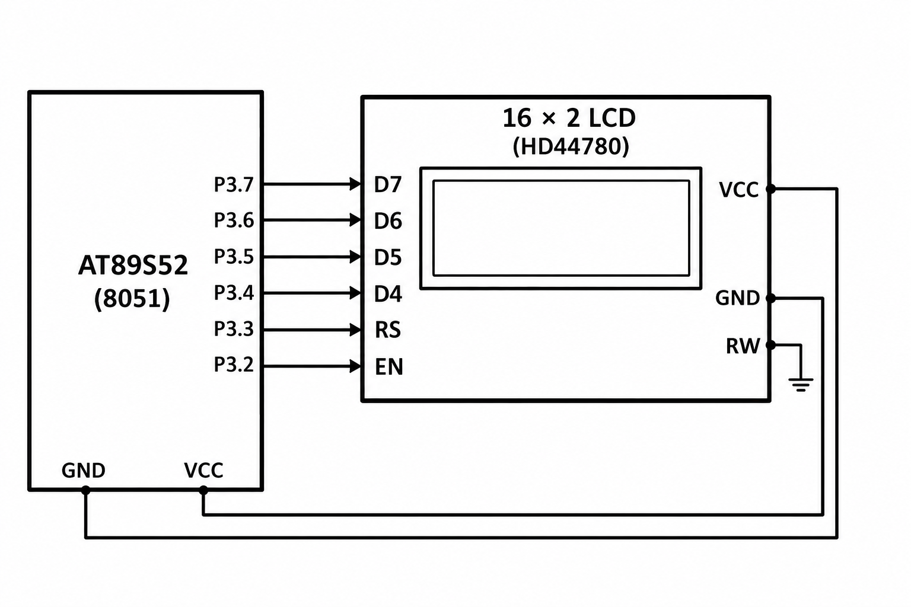

# CAT7 - Experiment Overview

HD44780 LCD interfacing and keypad-driven cursor control.

## Tasks

- [TASK7A](TASK7A/README.md) - Initialize a 16×2 HD44780-compatible display in four-bit mode and write a short message.
- [TASK7B](TASK7B/README.md) - Use LCD cursor positioning and repeated data updates to display a changing elapsed-seconds count.
- [TASK7C](TASK7C/README.md) - Use a 4×4 keypad to move a character around a 16×2 LCD using the direction keys 2, 8, 4, and 6.

## Circuit Overview

