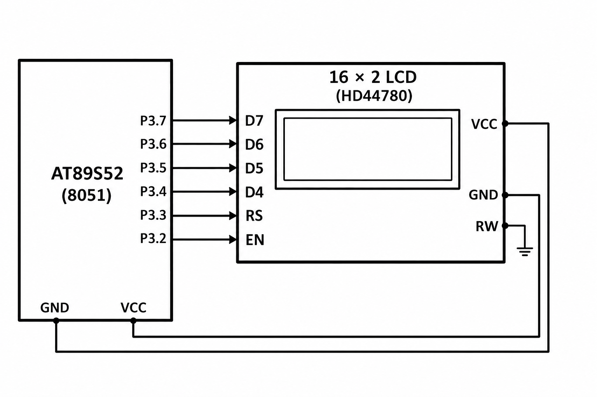

# 8051 16×2 LCD Initialization and Text Output

## Circuit / System Diagram

## Aim
Initialize a 16×2 HD44780-compatible display in four-bit mode and write a short message.

## Hardware and Components
- AT89S52 microcontroller board
- 16×2 HD44780-compatible LCD
- LCD contrast control and suitable display power connections

## Concepts Used
- LCD command and data transfers
- Four-bit parallel interface
- Display initialization

## Pin Connections / Wiring
| LCD signal | Microcontroller pin | Purpose |
|---|---|---|
| D4–D7 | P3.4–P3.7 | Four-bit data bus |
| EN | P3.2 | Enable strobe |
| RS | P3.3 | Command/data selection |
| RW | Ground | Write-only operation |

## Working / Implementation
The firmware performs the four-bit initialization sequence, selects a two-line display mode, enables the display, sets the entry direction, and clears the screen. It then sends the characters of `HELLO` as display data.

## Expected Output
`HELLO` appears on the first line of the LCD.
