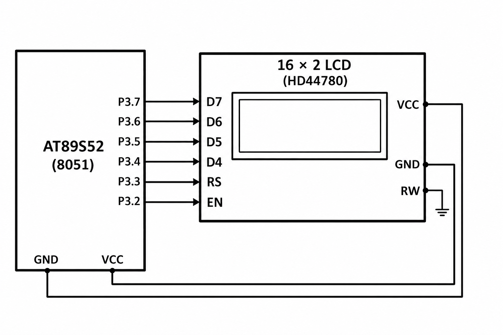

# 8051 LCD Cursor and Dynamic Value Display

## Circuit / System Diagram

## Aim
Use LCD cursor positioning and repeated data updates to display a changing elapsed-seconds count.

## Hardware and Components
- AT89S52 microcontroller board
- 16×2 HD44780-compatible LCD

## Concepts Used
- LCD four-bit interface
- Cursor addressing
- Number-to-text conversion
- Periodic display refresh

## Pin Connections / Wiring
| LCD signal | Microcontroller pin | Purpose |
|---|---|---|
| D4–D7 | P3.4–P3.7 | Four-bit data bus |
| EN | P3.2 | Enable strobe |
| RS | P3.3 | Command/data selection |
| RW | Ground | Write-only operation |

## Working / Implementation
The program initializes the display and uses LCD command helpers to position the cursor. It writes a fixed label on each line, converts the seconds counter into decimal digits, updates the value field, and increments the count once per second.

## Expected Output
The LCD shows an elapsed-seconds label and a decimal counter that increases over time.
