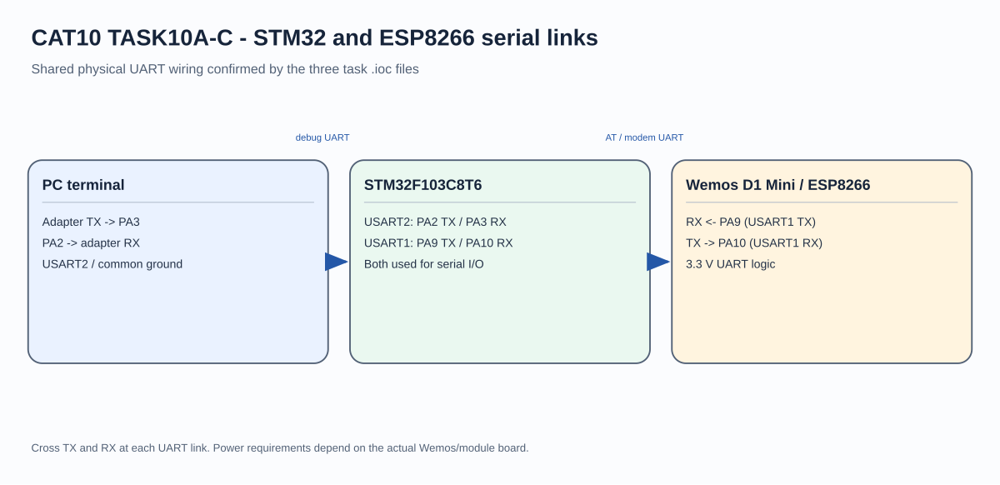

# CAT10 - Experiment Overview

STM32F103 and ESP8266 UART, AT commands, Wi-Fi status, and TCP server setup.

## Tasks

- [TASK10A](TASK10A/README.md) - Establish a serial bridge between an STM32F103C8, a Wemos D1 Mini/ESP8266, and a PC terminal.
- [TASK10B](TASK10B/README.md) - Use the STM32F103C8 UART interface to query an ESP8266 AT-command firmware and inspect its Wi-Fi information.
- [TASK10C](TASK10C/README.md) - Configure the ESP8266 as a Wi-Fi station and start a TCP server through AT commands sent by an STM32F103C8.

## Circuit Overview

