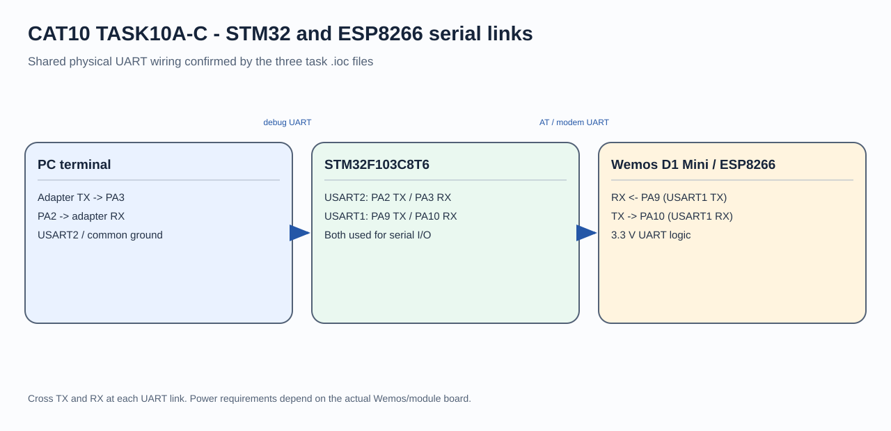
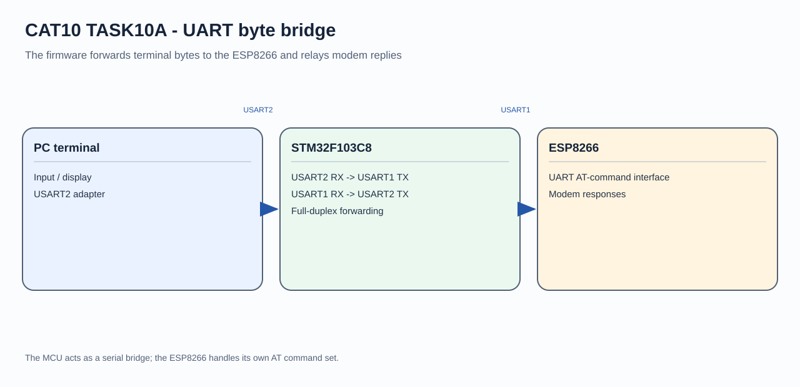

# STM32–ESP8266 UART Communication

## Circuit / System Diagram

## Aim
Establish a serial bridge between an STM32F103C8, a Wemos D1 Mini/ESP8266, and a PC terminal.

## Hardware and Components
- STM32F103C8 development board
- Wemos D1 Mini with ESP8266
- USB-to-TTL or PC serial terminal

## Concepts Used
- UART communication
- Full-duplex byte forwarding
- ESP8266 serial interface

## Pin Connections / Wiring
| Link | STM32 connection | Purpose |
|---|---|---|
| ESP8266 TX/RX | PA10 / PA9 (USART1 RX/TX) | Modem serial link |
| PC adapter TX/RX | PA3 / PA2 (USART2 RX/TX) | Debug terminal link |
| Ground | Common GND | Shared signal reference |

Cross TX to RX, use 3.3 V UART logic, and configure both links for 115200 baud, 8-N-1 as set in the project.

## Working / Implementation
The firmware forwards bytes from the PC terminal to USART1 and sends bytes received from the ESP8266 back to the terminal. This exposes the modem's serial exchange for interactive use.

## Expected Output
Terminal input is transmitted to the ESP8266; modem replies appear on the terminal.
