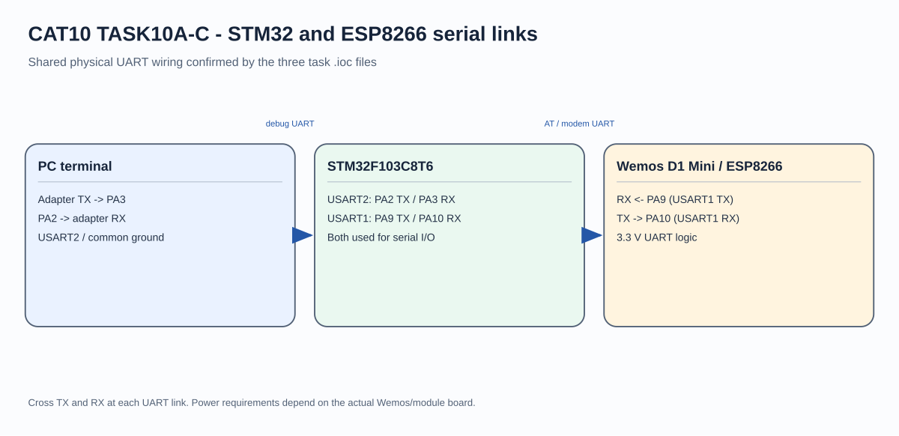
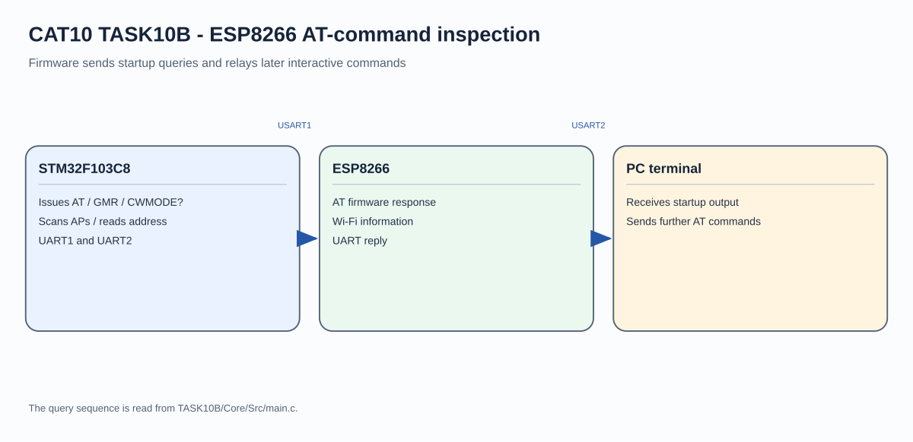

# STM32 ESP8266 AT Command Investigation

## Circuit / System Diagram

## Aim
Use the STM32F103C8 UART interface to query an ESP8266 AT-command firmware and inspect its Wi-Fi information.

## Hardware and Components
- STM32F103C8 development board
- Wemos D1 Mini/ESP8266 module
- PC serial terminal

## Concepts Used
- UART request and response
- ESP8266 AT commands
- Wi-Fi mode, access-point scan, and interface information

## Pin Connections / Wiring
| Link | STM32 connection | Purpose |
|---|---|---|
| ESP8266 TX/RX | PA10 / PA9 (USART1 RX/TX) | AT command channel |
| PC terminal TX/RX | PA3 / PA2 (USART2 RX/TX) | Command input and debug output |
| Ground | Common GND | Shared signal reference |

Both serial links are configured for 115200 baud, 8-N-1. Cross TX/RX and use 3.3 V UART logic.

## Working / Implementation
At startup the firmware sends `AT`, `AT+GMR`, `AT+CWMODE?`, `AT+CWLAP`, and `AT+CIFSR` to inspect firmware version, Wi-Fi mode, visible access points, and interface information. Responses are printed to the terminal. After the initial sequence, terminal bytes are forwarded to and from the module for further AT commands.

## Expected Output
The terminal shows ESP8266 responses to the startup queries and relays later interactive command responses.
