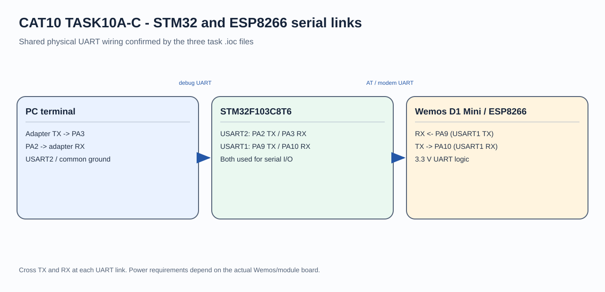
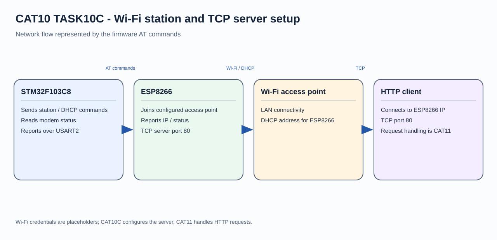

# STM32 ESP8266 Wi-Fi and TCP Server Setup

## Circuit / System Diagram

## Aim
Configure the ESP8266 as a Wi-Fi station and start a TCP server through AT commands sent by an STM32F103C8.

## Hardware and Components
- STM32F103C8 development board
- Wemos D1 Mini/ESP8266 module
- Wi-Fi access point
- PC serial terminal for status output

## Concepts Used
- UART AT-command control
- Wi-Fi station mode and DHCP
- Network status reporting
- TCP server configuration

## Pin Connections / Wiring
| Link | STM32 connection | Purpose |
|---|---|---|
| ESP8266 TX/RX | PA10 / PA9 (USART1 RX/TX) | AT command and response channel |
| PC terminal TX/RX | PA3 / PA2 (USART2 RX/TX) | Debug reporting |
| Ground | Common GND | Shared signal reference |

The UART links use 115200 baud, 8-N-1. Wi-Fi credentials are configured locally in the source.

## Working / Implementation
The firmware checks the modem, selects station mode, enables DHCP, and joins the configured access point. It reports the module's IP and connection status, enables multiple TCP connections, and starts a server on port 80. HTTP request processing is covered by the following CAT11 tasks.

## Expected Output
The debug terminal displays AT responses and reports the ESP8266 network status after server setup.
