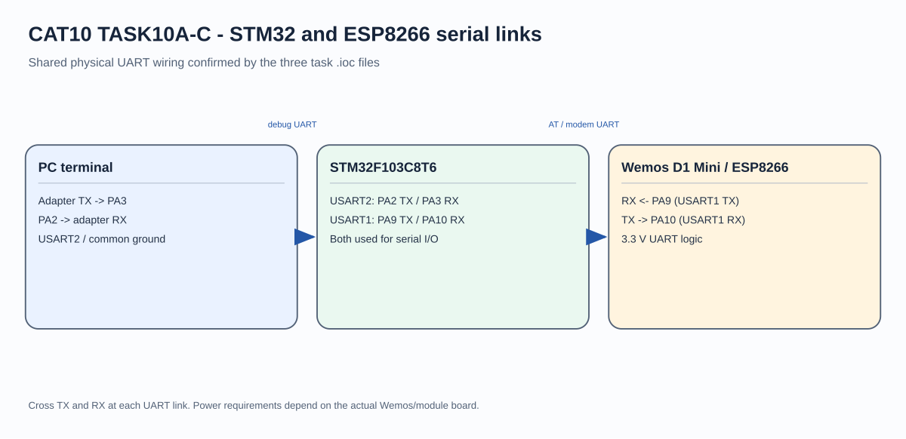

# CAT11 - Experiment Overview

HTTP request reception and response through the CAT10 ESP8266 server.

## Tasks

- [TASK11A](TASK11A/README.md) - Receive HTTP requests delivered by an ESP8266 TCP server and return an HTTP response from the STM32F103C8.
- [TASK11B](TASK11B/README.md) - Use Node-RED as a second HTTP client to request a page from the STM32/ESP8266 server and view its response.

## Circuit Overview

