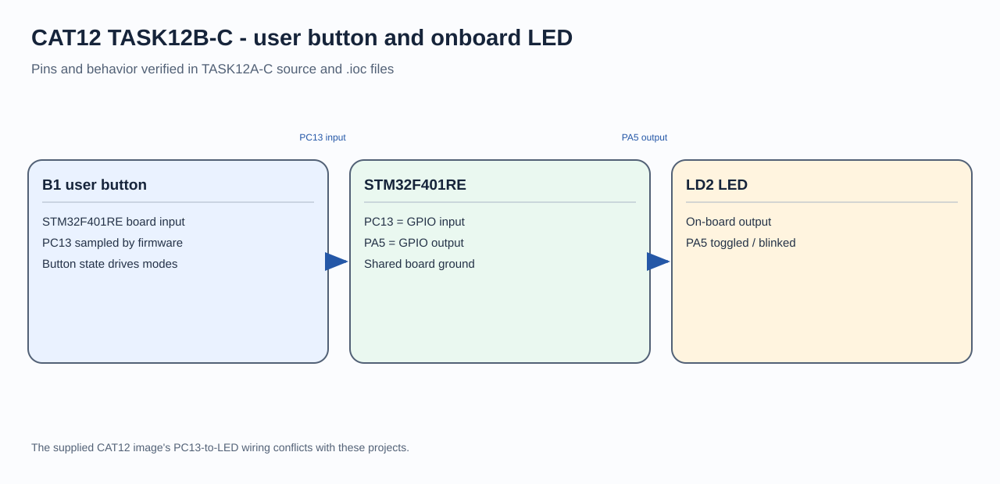

# CAT12 - Experiment Overview

STM32F401 GPIO output and user-button interaction.

## Tasks

- [TASK12A](TASK12A/README.md) - Initialize a GPIO output on the STM32F401RE and blink the NUCLEO-F401RE onboard LED.
- [TASK12B](TASK12B/README.md) - Use the NUCLEO-F401RE user button to toggle and retain the onboard LED state.
- [TASK12C](TASK12C/README.md) - Distinguish short and long presses of the NUCLEO-F401RE user button to control LD2.

## Circuit Overview

