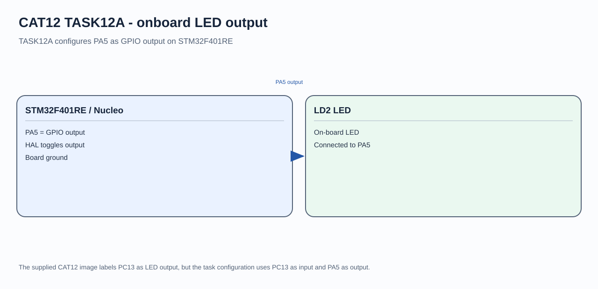

# STM32F401RE LED Blink

## Circuit / System Diagram

## Aim
Initialize a GPIO output on the STM32F401RE and blink the NUCLEO-F401RE onboard LED.

## Hardware and Components
- NUCLEO-F401RE development board
- Onboard green LD2 LED

## Concepts Used
- STM32 HAL initialization
- GPIO push-pull output
- Periodic delay and output toggling

## Pin Connections / Wiring
| Component | STM32 pin | Purpose |
|---|---|---|
| Onboard LD2 | PA5 | Active-high LED output |

## Working / Implementation
The firmware initializes the HAL, system clock, and GPIOA. It toggles PA5 and waits 500 ms before each next toggle.

## Expected Output
LD2 repeatedly switches between on and off, with a half-second delay between changes.
