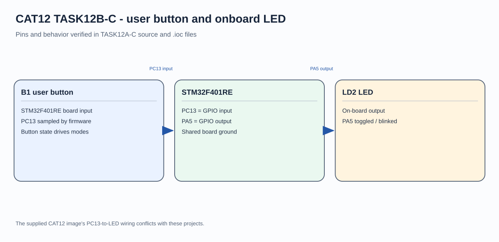

# STM32F401RE Button-Controlled LED State

## Circuit / System Diagram

## Aim
Use the NUCLEO-F401RE user button to toggle and retain the onboard LED state.

## Hardware and Components
- NUCLEO-F401RE development board
- B1 user button
- Onboard green LD2 LED

## Concepts Used
- GPIO input polling
- Press-edge detection and debounce
- GPIO output state retention

## Pin Connections / Wiring
| Component | STM32 pin | Purpose |
|---|---|---|
| B1 user button | PC13 | Active-high press input in the project |
| Onboard LD2 | PA5 | Active-high LED output |

## Working / Implementation
The firmware samples PC13 and detects a transition into the pressed state. After a 25 ms debounce interval it toggles PA5 once, then waits for release before accepting another press.

## Expected Output
Each press changes LD2 to the opposite state; the selected state remains after the button is released.
