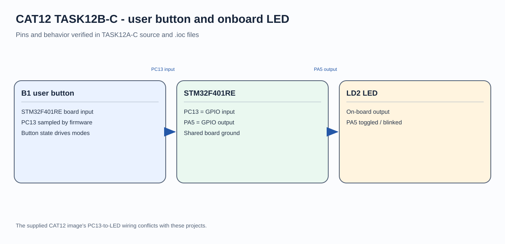

# STM32F401RE Short- and Long-Press LED Control

## Circuit / System Diagram

## Aim
Distinguish short and long presses of the NUCLEO-F401RE user button to control LD2.

## Hardware and Components
- NUCLEO-F401RE development board
- B1 user button
- Onboard green LD2 LED

## Concepts Used
- GPIO input polling
- Debounce and press-duration measurement
- Time-based operating modes

## Pin Connections / Wiring
| Component | STM32 pin | Purpose |
|---|---|---|
| B1 user button | PC13 | Active-high press input in the project |
| Onboard LD2 | PA5 | Active-high LED output |

## Working / Implementation
The program debounces a press and measures its duration with the HAL timebase. A press reaching one second starts periodic blinking. A shorter press toggles the steady LED state; a later short press exits blink mode.

## Expected Output
Short presses toggle LD2. Holding B1 for at least one second starts blinking, and a later short press stops the blinking mode.
