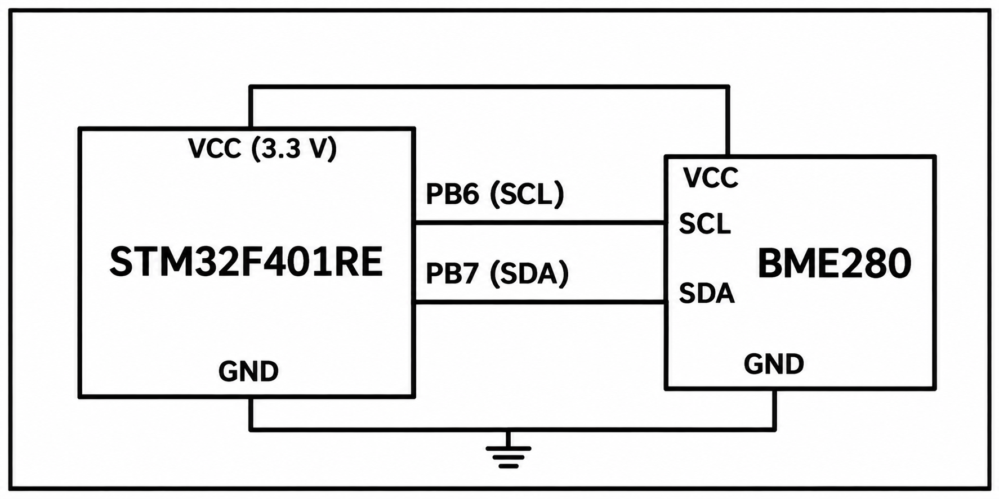

# CAT13 - Experiment Overview

BME280 temperature, pressure, and humidity acquisition over I2C.

## Tasks

- [TASK13](TASK13/README.md) - Interface a BME280 environmental sensor to the STM32F401RE over I²C and retrieve compensated temperature, pressure, and humidity data.

## Circuit Overview

