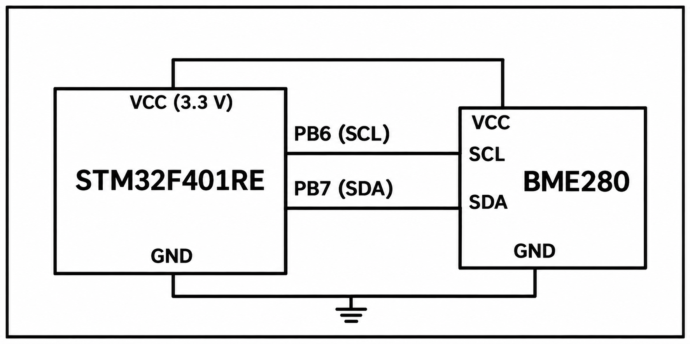

# STM32F401RE BME280 Sensor Acquisition

## Circuit / System Diagram

## Aim
Interface a BME280 environmental sensor to the STM32F401RE over I²C and retrieve compensated temperature, pressure, and humidity data.

## Hardware and Components
- STM32F401RE development board
- BME280 sensor module with I²C interface

## Concepts Used
- I²C master communication
- Bosch BME280 API and compensation data
- Periodic environmental measurement

## Pin Connections / Wiring
| BME280 signal | STM32 pin | Purpose |
|---|---|---|
| SCL | PB6 / I2C1_SCL | I²C clock |
| SDA | PB7 / I2C1_SDA | I²C data |
| Sensor address | 0x76 primary address | Selected in the source |
| Power and ground | Board-compatible supply and GND | Sensor power/reference |

Use the supply voltage supported by the specific sensor module and provide the I²C pull-ups required by that module.

## Working / Implementation
The Bosch driver is configured with STM32 HAL I²C read/write callbacks. The firmware initializes the sensor, selects 1× oversampling for temperature, pressure, and humidity, disables the filter, enters normal mode, and reads compensated values once per second. Pressure is converted from pascals to hectopascals.

## Expected Output
The program updates its temperature, pressure, and relative-humidity variables from successive BME280 measurements. This task's source does not send those values to an external display or network endpoint.
