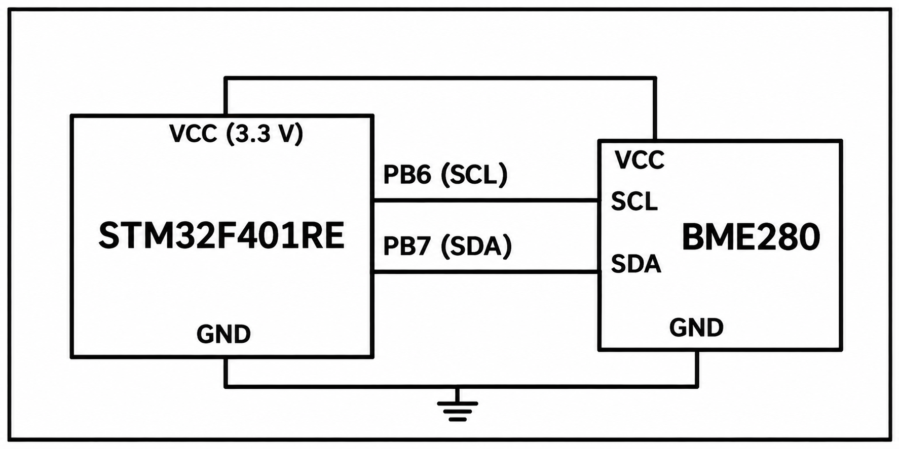

# CAT14 - Experiment Overview

BME280 telemetry over ESP8266 MQTT with Node-RED visualization support.

## Tasks

- [TASK14](TASK14/README.md) - Measure environmental conditions with a BME280 and publish JSON sensor data through an ESP8266 MQTT connection for Node-RED visualization.

## Circuit Overview

