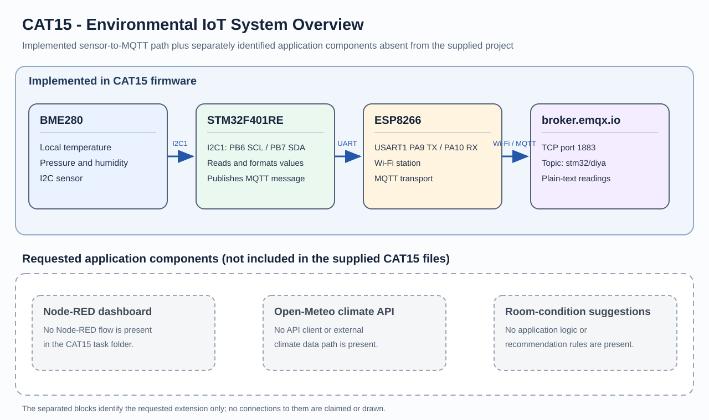

# CAT15 - Experiment Overview

Environmental telemetry, with requested external API and recommendation extensions documented separately.

## Tasks

- [TASK15](TASK15/README.md) - Build an environmental IoT application that acquires local room readings, sends them through Wi-Fi, and presents useful information to a user

## Circuit Overview

