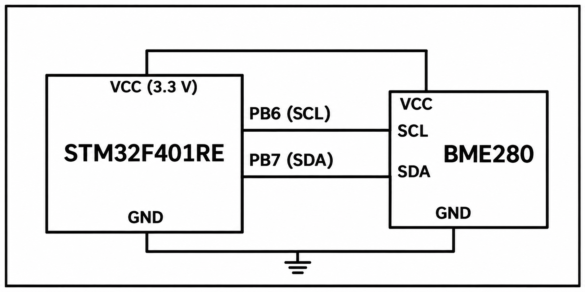
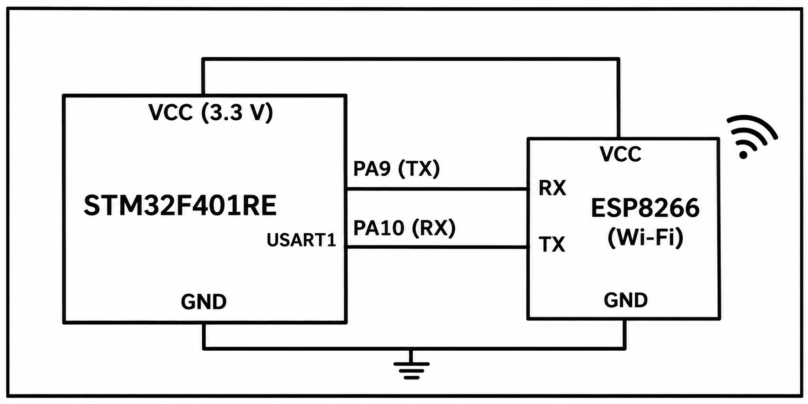
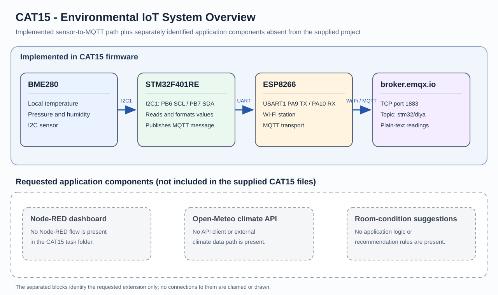

# CAT15 TASK15 - Environmental IoT Telemetry and Room-Condition Application

## Aim
Build an environmental IoT application that acquires local room readings, sends them through Wi-Fi, and presents useful information to a user. The supplied firmware implements BME280 acquisition and MQTT telemetry; the requested Open-Meteo and recommendation extensions are not present in the supplied project files.

## System Architecture
The implemented path is:

1. The BME280 measures local temperature, pressure, and relative humidity.
2. The STM32F401RE reads the sensor over I2C1 and formats the values.
3. The ESP8266 provides Wi-Fi connectivity through the STM32 USART1 UART link.
4. The firmware publishes a plain-text MQTT message to broker.emqx.io on port 1883, topic stm32/diya.

The requested end application extends this path with a Node-RED dashboard, Open-Meteo climate information, and room-condition suggestions. The CAT15 folder does not contain a Node-RED flow, Open-Meteo client, or recommendation logic, so these extensions are marked pending and are not drawn as connected data paths.

## Hardware and Components
- STM32F401RE development board
- BME280 environmental sensor
- ESP8266 Wi-Fi module
- Wi-Fi access point and MQTT broker

## Communication and Concepts
- BME280 sensor acquisition over I2C1 using the Bosch sensor API
- UART communication between the STM32 and ESP8266
- ESP8266 Wi-Fi station operation
- MQTT publishing to broker.emqx.io:1883
- Environmental data formatting and telemetry

Local sensor readings represent the physical room environment. Open-Meteo would provide external climate information if its client integration is added; it does not measure indoor room conditions.

## Circuit and System Diagrams

## Working
The firmware initializes the BME280 at address 0x76, configures I2C1 at 100 kHz, and reads compensated temperature, pressure, and humidity values. USART1 is configured at 115200 baud for the ESP8266 link. The firmware joins the configured Wi-Fi network, opens TCP to broker.emqx.io:1883, and publishes a text message containing the sensor readings on stm32/diya.

## Application and Purpose
The implemented telemetry lets a subscriber inspect local sensor readings remotely. In the intended complete application, a Node-RED dashboard could combine these local readings with external climate information and present practical room-condition suggestions. The supplied code does not establish the external API request, dashboard flow, or suggestion thresholds, so that behavior is not claimed as implemented.
