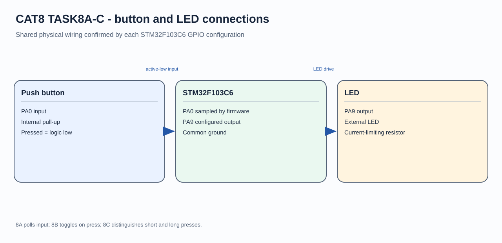

# CAT8 - Experiment Overview

STM32F103 GPIO input, button handling, and LED behavior.

## Tasks

- [TASK8A](TASK8A/README.md) - Demonstrate a digital input controlling a digital output on the STM32F103C6.
- [TASK8B](TASK8B/README.md) - Toggle an LED once for each accepted push-button press on the STM32F103C6.
- [TASK8C](TASK8C/README.md) - Use short and long presses on the STM32F103C6 to control an LED in steady and blinking modes.

## Circuit Overview

