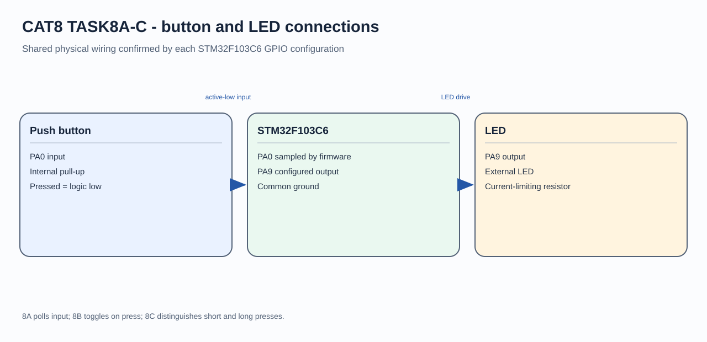

# STM32 GPIO Button-to-LED Control

## Circuit / System Diagram

## Aim
Demonstrate a digital input controlling a digital output on the STM32F103C6.

## Hardware and Components
- STM32F103C6 development board
- Push-button input
- LED with suitable current limiting

## Concepts Used
- GPIO input and output
- Active-low input logic
- Continuous polling

## Pin Connections / Wiring
| Component | Microcontroller pin | Purpose |
|---|---|---|
| Push-button input | PA0 | Input with internal pull-up; pressed state is low |
| LED | PA9 | Active-high output |

## Working / Implementation
After HAL, clock, and GPIO initialization, the main loop reads PA0 continuously. It writes PA9 high while the input reads low and writes it low otherwise.

## Expected Output
The LED follows the button state: it is on while the active-low button is pressed and off when released.
