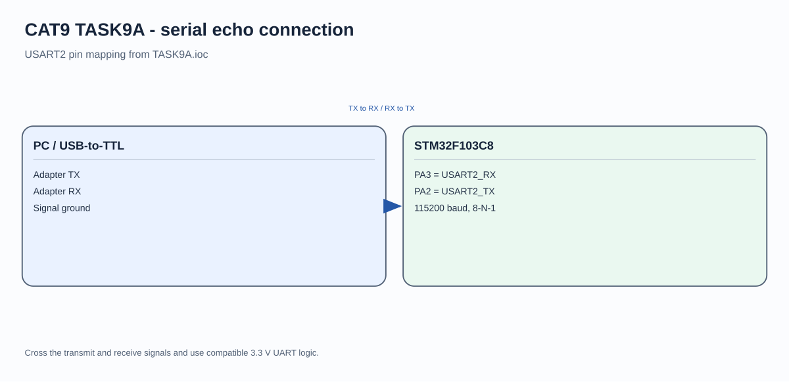

# CAT9 - Experiment Overview

STM32F103 USART communication and UART-controlled LED output.

## Tasks

- [TASK9A](TASK9A/README.md) - Initialize a USART peripheral on the STM32F103C8 and return characters received from a serial terminal.
- [TASK9B](TASK9B/README.md) - Control the STM32F103C8 LED output by sending text commands over USART1.

## Circuit Overview

