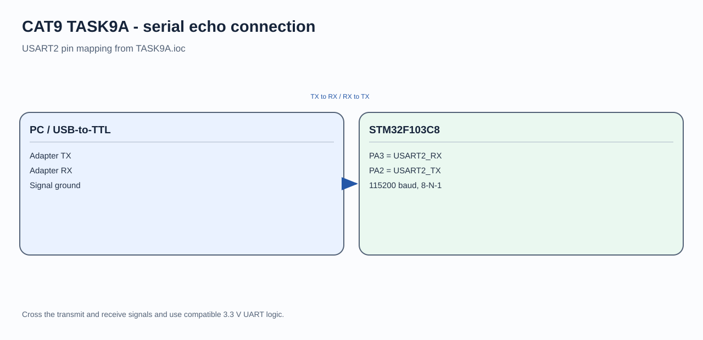

# STM32 UART Serial Echo

## Circuit / System Diagram

## Aim
Initialize a USART peripheral on the STM32F103C8 and return characters received from a serial terminal.

## Hardware and Components
- STM32F103C8 development board
- USB-to-TTL serial interface or compatible terminal

## Concepts Used
- UART receive and transmit
- Character echo
- Serial terminal interaction

## Pin Connections / Wiring
| Serial interface signal | STM32 pin | Purpose |
|---|---|---|
| Adapter TX | PA3 / USART2_RX | Sends characters to the MCU |
| Adapter RX | PA2 / USART2_TX | Receives echoed characters |
| Ground | GND | Shared signal reference |

The configured USART2 link uses 115200 baud, 8 data bits, no parity, and one stop bit.

## Working / Implementation
The firmware initializes USART2 and waits for a character. It sends the received character back; carriage return is followed by a line break. Other characters are echoed unchanged.

## Expected Output
Characters typed in the terminal appear again in the terminal, with a new line after carriage return.
